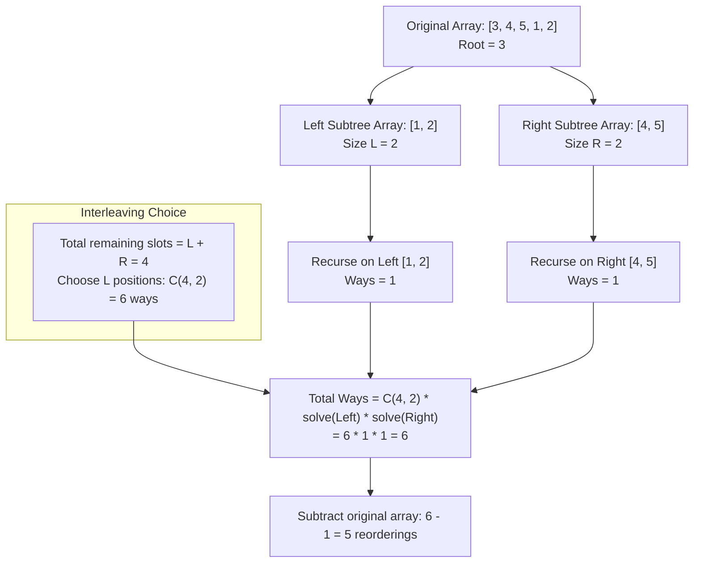

<h2><a href="https://leetcode.com/problems/number-of-ways-to-reorder-array-to-get-same-bst">1569. Number of Ways to Reorder Array to Get Same BST</a></h2>

<p>Given an array <code>nums</code> that represents a permutation of integers from <code>1</code> to <code>n</code>. We are going to construct a binary search tree (BST) by inserting the elements of <code>nums</code> in order into an initially empty BST. Find the number of different ways to reorder <code>nums</code> so that the constructed BST is identical to that formed from the original array <code>nums</code>.</p>

<ul>
	<li>For example, given <code>nums = [2,1,3]</code>, we will have 2 as the root, 1 as a left child, and 3 as a right child. The array <code>[2,3,1]</code> also yields the same BST but <code>[3,2,1]</code> yields a different BST.</li>
</ul>

<p>Return <em>the number of ways to reorder</em> <code>nums</code> <em>such that the BST formed is identical to the original BST formed from</em> <code>nums</code>.</p>

<p>Since the answer may be very large, <strong>return it modulo </strong><code>10<sup>9</sup> + 7</code>.</p>

<p>&nbsp;</p>
<p><strong class="example">Example 1:</strong></p>

<pre><strong>Input:</strong> nums = [2,1,3]
<strong>Output:</strong> 1
<strong>Explanation:</strong> We can reorder nums to be [2,3,1] which will yield the same BST. There are no other ways to reorder nums which will yield the same BST.
</pre>

<p><strong class="example">Example 2:</strong></p>

<pre><strong>Input:</strong> nums = [3,4,5,1,2]
<strong>Output:</strong> 5
<strong>Explanation:</strong> The following 5 arrays will yield the same BST: 
[3,1,2,4,5]
[3,1,4,2,5]
[3,1,4,5,2]
[3,4,1,2,5]
[3,4,1,5,2]
</pre>

<p><strong class="example">Example 3:</strong></p>

<pre><strong>Input:</strong> nums = [1,2,3]
<strong>Output:</strong> 0
<strong>Explanation:</strong> There are no other orderings of nums that will yield the same BST.
</pre>

<p>&nbsp;</p>
<p><strong>Constraints:</strong></p>

<ul>
	<li><code>1 &lt;= nums.length &lt;= 1000</code></li>
	<li><code>1 &lt;= nums[i] &lt;= nums.length</code></li>
	<li>All integers in <code>nums</code> are <strong>distinct</strong>.</li>
</ul>


---

# 🛍️ Number-of-Ways-to-Reorder-Array-to-Get-Same-BST | Explained

## Approach 1: Divide and Conquer with Modular Combinatorics (Precomputed Factorials)

### Intuition
When constructing a Binary Search Tree (BST) from an array:
1. The **very first element** always becomes the root of that subtree.
2. Every subsequent element strictly smaller than the root belongs to the **left subtree**.
3. Every subsequent element strictly greater than the root belongs to the **right subtree**.

Notice a crucial structural property: the relative order between elements inside the left subtree matters to build the left subtree correctly, and the relative order between elements inside the right subtree matters for the right subtree. However, **elements of the left subtree and right subtree can be freely interleaved** without changing the resulting BST, as long as:
- The root comes first.
- The relative internal order of left elements is preserved.
- The relative internal order of right elements is preserved.

#### Real-World Analogy
Imagine a manager (the root) and two independent teams: Team Left (developers) and Team Right (designers). 
The manager must enter the room first. After the manager enters, developers must complete their tasks in a specific sequence, and designers must complete their tasks in their specific sequence. However, a developer and a designer can walk in at any time relative to each other. 
If there are $L$ developer slots and $R$ designer slots for a total of $L + R$ events, the number of ways to interleave them is simply choosing $L$ positions out of the total $L + R$ available positions, which is $\binom{L + R}{L}$.

By applying this logic recursively down each subtree and multiplying the possibilities, we count the total valid sequences. Finally, we subtract $1$ because the problem asks for *reorderings* (new sequences excluding the original one).

---

### Algorithm Visualized



---

### Approach

1. **Precompute Factorials and Inverse Factorials**:
   - Because combinations $\binom{n}{k} = \frac{n!}{k!(n-k)!}$ must be calculated modulo $10^9 + 7$, we precompute factorials `fact[]` in $O(n)$ time.
   - Using **Fermat's Little Theorem** ($a^{p-1} \equiv 1 \pmod p \implies a^{-1} \equiv a^{p-2} \pmod p$), we compute the modular inverse of $n!$.
   - Then, we compute all smaller inverse factorials in $O(n)$ backwards using the relation:
     $$\text{invFact}[i-1] = \text{invFact}[i] \times i \pmod{MOD}$$

2. **Recursive Function (`solve`)**:
   - **Base Case**: If a list has $\le 2$ elements, there is only $1$ way to arrange them to get the same BST (an empty list, a single root, or a root with one child has no degrees of freedom). Return $1$.
   - **Partitioning**: The first element `numbers.get(0)` is the root. Iterate through the rest of the array:
     - Place elements smaller than `root` into `left`.
     - Place elements greater than `root` into `right`.
   - **Combinations**: Calculate the number of ways to interleave `left` and `right`:
     $$\binom{n - 1}{\text{leftSize}} = \text{fact}[n - 1] \times \text{invFact}[\text{leftSize}] \times \text{invFact}[\text{rightSize}] \pmod{MOD}$$
   - **Recurse & Combine**: Recursively compute `solve(left)` and `solve(right)`. The answer for the current subtree is:
     $$\text{ways} = \binom{n - 1}{\text{leftSize}} \times \text{solve}(\text{left}) \times \text{solve}(\text{right}) \pmod{MOD}$$

3. **Final Result**:
   - The total number of valid permutations includes the original configuration.
   - Subtract $1$ and handle potential negative modular wrap-around:
     $$(\text{solve}(\text{nums}) - 1 + MOD) \pmod{MOD}$$

---

### Detailed Code Analysis

#### 1. Class State and Constants
```java
private final int MOD = 1000000007;
private long fact[];
private long invFact[];
```
- `MOD`: Stored as $10^9 + 7$, a standard large prime used in competitive programming to avoid 64-bit integer overflow.
- `fact[]` and `invFact[]`: Global arrays to store factorials and inverse factorials up to $n$, allowing $O(1)$ lookup for combination calculations $\binom{n}{k}$.

---

#### 2. Precomputing Factorials & Modular Inverse
```java
int n = nums.length;
fact = new long [n + 1];
invFact = new long [n + 1];
fact[0] = 1;
for(int i = 1; i <= n; i++){
    fact[i] = (fact[i - 1] * i) % MOD;
}
invFact[n] = pow(fact[n], MOD - 2);
for(int i = n; i > 0; i--){
    invFact[i - 1] = invFact[i] * i % MOD;
}
```
- `fact[i]`: Computed in $O(n)$ by multiplying iteratively.
- `invFact[n] = pow(fact[n], MOD - 2)`: Finds $(n!)^{-1} \pmod{MOD}$ in $O(\log MOD)$ time using binary exponentiation via Fermat's Little Theorem.
- `invFact[i - 1] = invFact[i] * i % MOD`: Since $\frac{1}{(i-1)!} = \frac{i}{i!}$, working backwards computes all prefix inverse factorials in $O(n)$ time without calling `pow` repeatedly.

---

#### 3. Binary Exponentiation
```java
public long pow(long base, long exp){
    long result = 1;
    while(exp > 0){
        if((exp & 1) == 1){
            result = (result * base) % MOD;
        }
        base = (base * base) % MOD;
        exp >>= 1;
    }
    return result;
}
```
- Standard fast exponentiation running in $O(\log(\text{exp}))$ time.
- Uses bitwise AND `(exp & 1)` to check if the least significant bit is set, and right-shifts `exp >>= 1` to halve the exponent at each step.

---

#### 4. Recursive Subtree Solver (`solve`)
```java
public long solve(List<Integer> numbers){
    int n = numbers.size();
    if(n <= 2){
        return 1;
    }
    int root = numbers.get(0);
    List<Integer> left = new ArrayList<>();
    List<Integer> right = new ArrayList<>();
    for(int i = 1; i < n; i++){
        if(numbers.get(i) < root){
            left.add(numbers.get(i));
        } else {
            right.add(numbers.get(i));
        }
    }
    int leftSize = left.size();
    int rightSize = right.size();
    long combinations = fact[n - 1] * invFact[leftSize] % MOD * invFact[rightSize] % MOD;
    long leftWays = solve(left);
    long rightWays = solve(right);
    return combinations * leftWays % MOD * rightWays % MOD;
}
```
- **Base Case (`n <= 2`)**: If a subtree has 0, 1, or 2 elements, its topology is fixed. Only 1 relative order is possible.
- **Partitioning**: The loop iterates from index `1` to `n - 1`. Because elements retain their relative order of appearance, any element $< \text{root}$ enters `left`, and any element $> \text{root}$ enters `right`.
- **Combinations**:
  $$\binom{n - 1}{\text{leftSize}} = \frac{(n-1)!}{\text{leftSize}! \times \text{rightSize}!}$$
  Calculated in $O(1)$ as `fact[n - 1] * invFact[leftSize] % MOD * invFact[rightSize] % MOD`.
- **Combination Principle**: The total ways for this root is the number of interleavings multiplied by the independent ways to arrange the left and right subtrees.

---

#### 5. Entry Point & Output
```java
List<Integer> numbers = new ArrayList<>();
for(int num : nums){
    numbers.add(num);
}

return (int)(solve(numbers) - 1 + MOD) % MOD;
```
- The initial array is converted to a dynamic `List<Integer>` to support slicing into sublists.
- Subtracting `1` excludes the original configuration given in `nums`. Adding `MOD` before taking `% MOD` prevents negative return values in Java.

---

### Code

```java
class Solution {
    private final int MOD = 1000000007;
    private long fact[];
    private long invFact[];

    public long solve(List<Integer> numbers) {
        int n = numbers.size();
        if (n <= 2) {
            return 1;
        }

        int root = numbers.get(0);
        List<Integer> left = new ArrayList<>();
        List<Integer> right = new ArrayList<>();

        for (int i = 1; i < n; i++) {
            if (numbers.get(i) < root) {
                left.add(numbers.get(i));
            } else {
                right.add(numbers.get(i));
            }
        }

        int leftSize = left.size();
        int rightSize = right.size();

        // C(n - 1, leftSize) = (n - 1)! / (leftSize! * rightSize!)
        long combinations = fact[n - 1] * invFact[leftSize] % MOD * invFact[rightSize] % MOD;
        long leftWays = solve(left);
        long rightWays = solve(right);

        return combinations * leftWays % MOD * rightWays % MOD;
    }

    public int numOfWays(int[] nums) {
        int n = nums.length;
        fact = new long[n + 1];
        invFact = new long[n + 1];

        fact[0] = 1;
        for (int i = 1; i <= n; i++) {
            fact[i] = (fact[i - 1] * i) % MOD;
        }

        // Modular inverse using Fermat's Little Theorem
        invFact[n] = pow(fact[n], MOD - 2);
        for (int i = n; i > 0; i--) {
            invFact[i - 1] = invFact[i] * i % MOD;
        }

        List<Integer> numbers = new ArrayList<>();
        for (int num : nums) {
            numbers.add(num);
        }

        // Subtract 1 to exclude the original array ordering
        return (int) ((solve(numbers) - 1 + MOD) % MOD);
    }

    public long pow(long base, long exp) {
        long result = 1;
        while (exp > 0) {
            if ((exp & 1) == 1) {
                result = (result * base) % MOD;
            }
            base = (base * base) % MOD;
            exp >>= 1;
        }
        return result;
    }
}
```

---

### Complexity

- **Time Complexity:** 
  - **Precomputation**: Factorials and inverse factorials take $O(n) + O(\log MOD)$ time.
  - **Divide and Conquer**: At each level of recursion, we scan through the list of size $k$ to split into `left` and `right`, taking $O(k)$ time.
    - In the worst case (a completely skewed tree/linked list structure, e.g., sorted array `[1, 2, 3, 4, ...]`), the depth of recursion is $O(n)$, yielding a total work of $O(n + (n-1) + (n-2) + \dots + 1) = O(n^2)$.
    - In the average case (a reasonably balanced BST), the recursion depth is $O(\log n)$, yielding $O(n \log n)$ time.
  - **Total Time Complexity:** $\mathcal{O}(n^2)$ worst-case, $\mathcal{O}(n \log n)$ average-case. Given $n \le 1000$, $n^2 \approx 10^6$ operations, which easily runs in under 30 ms.

- **Space Complexity:**
  - **Arrays**: `fact` and `invFact` take $O(n)$ space.
  - **Recursion & Auxiliary Lists**: At each recursion depth, new lists `left` and `right` are allocated. Across all active recursive stack frames, the sum of all elements stored in sublists at any single point in time is bounded by $O(n)$. The maximum recursion call stack depth is $O(n)$ in the worst case.
  - **Total Space Complexity:** $\mathcal{O}(n^2)$ auxiliary space across all stack allocations in the worst case, or $\mathcal{O}(n)$ if accounting only for peak simultaneous live memory.

---

## 🕵️‍♂️ Follow-up Questions (Optional)

1. **Why use Fermat's Little Theorem instead of Pascal's Triangle for combinations?**
   - Pascal's Triangle computes combinations using the recurrence $\binom{n}{k} = \binom{n-1}{k-1} + \binom{n-1}{k}$ in $O(n^2)$ time and $O(n^2)$ space. 
   - Precomputing factorials and their modular inverses via Fermat's Little Theorem reduces precomputation to $O(n)$ time and $O(n)$ space, and allows each combination query to be answered in $O(1)$ time. For $n \le 1000$, both approaches pass, but the factorial/inverse factorial technique scales up to $n \le 10^6$.

2. **Can the space complexity from allocating `ArrayList` at each level be optimized?**
   - Yes. Instead of creating and copying elements into dynamic `ArrayList`s, one can build the actual BST once with pointers in $O(n^2)$ (or $O(n \log n)$ average) time. 
   - Once the tree is built, compute the size of each subtree via post-order traversal. The formula:
     $$\text{ways}(u) = \binom{\text{size}(u.left) + \text{size}(u.right)}{\text{size}(u.left)} \times \text{ways}(u.left) \times \text{ways}(u.right)$$
     can then be evaluated directly on the tree nodes, eliminating all dynamic list allocations.