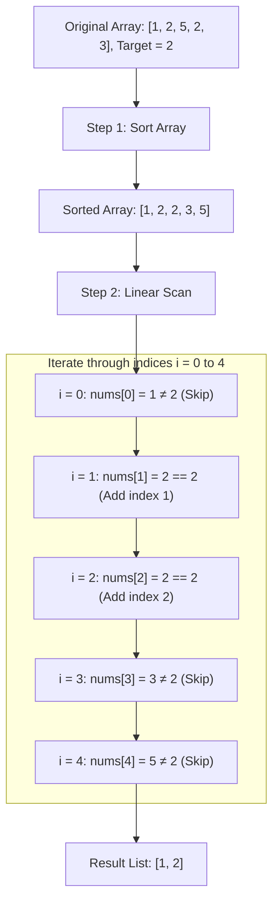

<h2><a href="https://leetcode.com/problems/find-target-indices-after-sorting-array">2089. Find Target Indices After Sorting Array</a></h2>

<p>You are given a <strong>0-indexed</strong> integer array <code>nums</code> and a target element <code>target</code>.</p>

<p>A <strong>target index</strong> is an index <code>i</code> such that <code>nums[i] == target</code>.</p>

<p>Return <em>a list of the target indices of</em> <code>nums</code> after<em> sorting </em><code>nums</code><em> in <strong>non-decreasing</strong> order</em>. If there are no target indices, return <em>an <strong>empty</strong> list</em>. The returned list must be sorted in <strong>increasing</strong> order.</p>

<p>&nbsp;</p>
<p><strong class="example">Example 1:</strong></p>

<pre><strong>Input:</strong> nums = [1,2,5,2,3], target = 2
<strong>Output:</strong> [1,2]
<strong>Explanation:</strong> After sorting, nums is [1,<u><strong>2</strong></u>,<u><strong>2</strong></u>,3,5].
The indices where nums[i] == 2 are 1 and 2.
</pre>

<p><strong class="example">Example 2:</strong></p>

<pre><strong>Input:</strong> nums = [1,2,5,2,3], target = 3
<strong>Output:</strong> [3]
<strong>Explanation:</strong> After sorting, nums is [1,2,2,<u><strong>3</strong></u>,5].
The index where nums[i] == 3 is 3.
</pre>

<p><strong class="example">Example 3:</strong></p>

<pre><strong>Input:</strong> nums = [1,2,5,2,3], target = 5
<strong>Output:</strong> [4]
<strong>Explanation:</strong> After sorting, nums is [1,2,2,3,<u><strong>5</strong></u>].
The index where nums[i] == 5 is 4.
</pre>

<p>&nbsp;</p>
<p><strong>Constraints:</strong></p>

<ul>
	<li><code>1 &lt;= nums.length &lt;= 100</code></li>
	<li><code>1 &lt;= nums[i], target &lt;= 100</code></li>
</ul>


---

# 🛍️ Find-Target-Indices-After-Sorting-Array | Explained

## Approach 1: Sort and Linear Scan

### Intuition
Imagine a group of students standing in a random line, each holding a card with a test score. You are asked to find the seat numbers of all students who scored a specific `target` mark, but there is a catch: they must first be rearranged in non-decreasing order from lowest score to highest score. 

The most straightforward way to solve this is to simply follow the problem's instructions directly:
1. Have all students rearrange themselves in sorted order.
2. Walk down the line from seat index `0` to the end.
3. Every time you see a student holding the `target` score, jot down their current seat index.

Because the students are already lined up in order from left to right, any matching target values will appear consecutively, and recording their indices as you walk naturally produces an answer in ascending order.

---

### Algorithm Visualized



---

### Approach

1. **Initialize Output Container:** Create a dynamic list `ans` to store the target indices since the total count of matches is not known in advance.
2. **Sort the Input:** Sort `nums` in ascending order using Java's built-in sorting method `Arrays.sort()`.
3. **Scan and Filter:**
   - Loop through the sorted array using an index pointer `i` starting from `0` up to `nums.length - 1`.
   - At each position, check if `nums[i] == target`.
   - If it matches, append the current index `i` to `ans`.
4. **Return Result:** Return the list `ans`. Because iteration progresses from `0` upwards, the collected indices are guaranteed to be in strictly increasing order.

---

### Detailed Code Analysis

```java
class Solution {
    public List<Integer> targetIndices(int[] nums, int target) {
        // Line 3: Initialize an ArrayList to collect our matching indices dynamically.
        List<Integer> ans = new ArrayList<>();
        
        // Line 4: In-place sorting of the primitive int array.
        // In Java, Arrays.sort(int[]) utilizes a Dual-Pivot Quicksort algorithm.
        Arrays.sort(nums);
        
        // Lines 5-9: Traverse the sorted array from left to right.
        for (int i = 0; i < nums.length; i++) {
            // Check if the current element matches the target value.
            if (nums[i] == target) {
                // If a match is found, append index 'i' to the list.
                ans.add(i);
            }
        }
        
        // Line 10: Return the populated list of indices.
        return ans;
    }
}
```

- **`List<Integer> ans = new ArrayList<>();`**: An `ArrayList` is chosen here because it provides $O(1)$ amortized insertion time and dynamically resizes as new target indices are discovered.
- **`Arrays.sort(nums);`**: Reorders the elements in $O(N \log N)$ time directly inside the input array, fulfilling the requirement that target indices must correspond to the sorted state.
- **`for(int i = 0; i < nums.length; i++)`**: Performs a full linear pass through the array. 
- **`if(nums[i] == target)`**: Evaluates each item. Since the array is sorted, all matching elements will form a contiguous subarray. Walking sequentially guarantees the resulting indices are added in ascending order without requiring a second sort on `ans`.

---

### Code

```java
class Solution {
    public List<Integer> targetIndices(int[] nums, int target) {
        List<Integer> ans = new ArrayList<>();
        Arrays.sort(nums);
        for (int i = 0; i < nums.length; i++) {
            if (nums[i] == target) {
                ans.add(i);
            }
        }
        return ans;
    }
}
```

---

### Complexity

- **Time Complexity:** $\mathcal{O}(N \log N)$
  - `Arrays.sort(nums)` runs in $\mathcal{O}(N \log N)$ average and worst-case time for primitive arrays (Dual-Pivot Quicksort).
  - The subsequent `for` loop inspects each element once, which takes $\mathcal{O}(N)$ time.
  - Overall dominant time complexity: $\mathcal{O}(N \log N) + \mathcal{O}(N) = \mathcal{O}(N \log N)$, where $N$ is the number of elements in `nums`.

- **Space Complexity:** $\mathcal{O}(\log N)$ auxiliary space
  - The in-place primitive sort `Arrays.sort(nums)` requires $\mathcal{O}(\log N)$ stack space for recursion.
  - The output list `ans` stores at most $N$ integers in the worst case (when all elements equal `target`), taking $\mathcal{O}(K)$ auxiliary space where $K \le N$ is the number of occurrences of `target`.

---

## 🕵️‍♂️ Follow-up Questions (Optional)

### 1. Can we solve this problem in $\mathcal{O}(N)$ time without sorting the array at all?
**Answer:** Yes! In a sorted array, an element's index is determined strictly by how many elements are smaller than it. 
- Count how many numbers in `nums` are strictly less than `target` (`lessThanCount`).
- Count how many numbers in `nums` are equal to `target` (`equalCount`).
- The target elements will occupy indices starting at `lessThanCount` up to `lessThanCount + equalCount - 1`.
- This reduces the time complexity to a single pass $\mathcal{O}(N)$ with $\mathcal{O}(1)$ extra space (excluding the result list).

### 2. Can we optimize the search phase after sorting to $\mathcal{O}(\log N)$?
**Answer:** Yes. Since the array is sorted, you do not need to scan the entire array with an $\mathcal{O}(N)$ linear scan. You can use **Binary Search** (`lower_bound` and `upper_bound`) to find the first and last occurrence of `target` in $\mathcal{O}(\log N)$ time, then fill the indices between them.