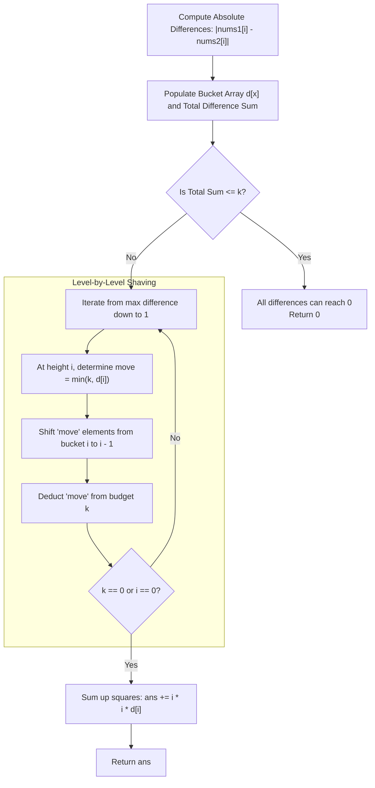

<h2><a href="https://leetcode.com/problems/minimum-sum-of-squared-difference">2333. Minimum Sum of Squared Difference</a></h2>

<p>You are given two positive <strong>0-indexed</strong> integer arrays <code>nums1</code> and <code>nums2</code>, both of length <code>n</code>.</p>

<p>The <strong>sum of squared difference</strong> of arrays <code>nums1</code> and <code>nums2</code> is defined as the <strong>sum</strong> of <code>(nums1[i] - nums2[i])<sup>2</sup></code> for each <code>0 &lt;= i &lt; n</code>.</p>

<p>You are also given two positive integers <code>k1</code> and <code>k2</code>. You can modify any of the elements of <code>nums1</code> by <code>+1</code> or <code>-1</code> at most <code>k1</code> times. Similarly, you can modify any of the elements of <code>nums2</code> by <code>+1</code> or <code>-1</code> at most <code>k2</code> times.</p>

<p>Return <em>the minimum <strong>sum of squared difference</strong> after modifying array </em><code>nums1</code><em> at most </em><code>k1</code><em> times and modifying array </em><code>nums2</code><em> at most </em><code>k2</code><em> times</em>.</p>

<p><strong>Note</strong>: You are allowed to modify the array elements to become <strong>negative</strong> integers.</p>

<p>&nbsp;</p>
<p><strong class="example">Example 1:</strong></p>

<pre><strong>Input:</strong> nums1 = [1,2,3,4], nums2 = [2,10,20,19], k1 = 0, k2 = 0
<strong>Output:</strong> 579
<strong>Explanation:</strong> The elements in nums1 and nums2 cannot be modified because k1 = 0 and k2 = 0. 
The sum of square difference will be: (1 - 2)<sup>2 </sup>+ (2 - 10)<sup>2 </sup>+ (3 - 20)<sup>2 </sup>+ (4 - 19)<sup>2</sup>&nbsp;= 579.
</pre>

<p><strong class="example">Example 2:</strong></p>

<pre><strong>Input:</strong> nums1 = [1,4,10,12], nums2 = [5,8,6,9], k1 = 1, k2 = 1
<strong>Output:</strong> 43
<strong>Explanation:</strong> One way to obtain the minimum sum of square difference is: 
- Increase nums1[0] once.
- Increase nums2[2] once.
The minimum of the sum of square difference will be: 
(2 - 5)<sup>2 </sup>+ (4 - 8)<sup>2 </sup>+ (10 - 7)<sup>2 </sup>+ (12 - 9)<sup>2</sup>&nbsp;= 43.
Note that, there are other ways to obtain the minimum of the sum of square difference, but there is no way to obtain a sum smaller than 43.</pre>

<p>&nbsp;</p>
<p><strong>Constraints:</strong></p>

<ul>
	<li><code>n == nums1.length == nums2.length</code></li>
	<li><code>1 &lt;= n &lt;= 10<sup>5</sup></code></li>
	<li><code>0 &lt;= nums1[i], nums2[i] &lt;= 10<sup>5</sup></code></li>
	<li><code>0 &lt;= k1, k2 &lt;= 10<sup>9</sup></code></li>
</ul>


---

# 🛍️ Minimum-Sum-of-Squared-Difference | Explained

## Approach 1: Bucket Frequency Array (Level-by-Level Reduction)

### Intuition
Imagine you have several pillars of varying heights, and your goal is to minimize the total area if each pillar's height is squared. Due to the properties of quadratic functions, reducing a taller pillar yields a significantly larger reduction than reducing a shorter one:

$$\Delta(x^2) = x^2 - (x - 1)^2 = 2x - 1$$

Reducing a pillar from height $10$ to $9$ saves $2(10) - 1 = 19$, whereas reducing a pillar from $2$ to $1$ only saves $2(2) - 1 = 3$. Therefore, the optimal greedy strategy is always to shave down the tallest pillars first.

Because modifying $nums1[i]$ by $+1/-1$ or modifying $nums2[i]$ by $-1/+1$ has the exact same effect on their absolute difference, we can pool our operations into a single total budget:

$$k = k_1 + k_2$$

Since the maximum possible difference between any pair of elements is bounded by the problem constraints ($|nums1[i] - nums2[i]| \le 10^5$), we do not need a priority queue. Instead, we can use a **bucket frequency array** to count how many differences exist at each magnitude, then shave off the highest peaks level-by-level like a descending water line.

### Algorithm Visualized



### Approach

1. **Pool the Operations**: Combine the modification allowances into a single budget $k = k_1 + k_2$.
2. **Frequency Bucketing**: 
   - Construct a frequency array `d` of size $100,001$ where `d[x]` stores the number of pairs with an absolute difference of $x$.
   - Simultaneously calculate the total sum of all differences (`sum`) and identify the maximum difference (`max`).
3. **Early Exit**: If the total sum of all differences is less than or equal to $k$, we have enough operations to reduce every single difference to $0$. Return $0$ immediately.
4. **Cascading Shaving (The Core Mechanic)**:
   - Iterate downwards from `i = max` to `1`.
   - At level `i`, we have `d[i]` differences of size `i`. We want to reduce as many of them as possible by $1$ (moving them to size `i - 1`).
   - The number of elements we can push down is `move = Math.min(k, d[i])`.
   - Decrement `d[i]` by `move`, increment `d[i - 1]` by `move`, and deduct `move` from `k`.
   - **Why a single pass works:** If $k > d[i]$, *all* elements at level `i` are pushed to `i - 1`. In the subsequent iteration, `i` decrements to `i - 1`, and these same elements (along with any elements originally at `i - 1`) are eligible to be pushed down again to `i - 2`. Mathematically, the sum of counts $\sum_{i=1}^{max} (\text{count of elements} \ge i)$ equals the total sum of differences. Because $sum > k$, the budget $k$ is guaranteed to hit $0$ before or at $i = 1$.
5. **Calculate the Minimum Squared Sum**:
   - Loop through the frequency array from $0$ to `max` and compute $\sum i^2 \times d[i]$.

### Detailed Code Analysis

```java
class Solution {
    public long minSumSquareDiff(int[] nums1, int[] nums2, int k1, int k2) {
        // Frequency array sized to constraint: max value of nums[i] is 10^5
        int[] d = new int[100001];
        long k = (long) k1 + k2, sum = 0;
        int max = 0;

        // Step 1: count the differences
        for (int i = 0; i < nums1.length; i++) {
            int x = Math.abs(nums1[i] - nums2[i]);
            d[x]++;
            sum += x;
            max = Math.max(max, x);
        }

        // Enough budget -> every difference becomes 0
        if (sum <= k) return 0;

        // Step 2: shave the biggest differences, level by level
        for (int i = max; i > 0 && k > 0; i--) {
            long move = Math.min(k, d[i]);
            d[i] -= move;
            d[i - 1] += move;
            k -= move;
        }

        // Step 3: add up the squares
        long ans = 0;
        for (int i = 0; i <= max; i++)
            ans += (long) i * i * d[i];

        return ans;
    }
}
```

- **`long k = (long) k1 + k2;`**:
  `k1` and `k2` can each be up to $10^9$. Their sum can exceed $2^{31} - 1$, so casting to `long` prevents integer overflow.
- **`sum += x;`**:
  Tracks the total $L_1$ norm (Manhattan distance) across all pairs. If `sum <= k`, every difference can be reduced to zero, avoiding unnecessary simulation.
- **`long move = Math.min(k, d[i]);`**:
  Prevents overspending. We can only move at most `d[i]` items down to the next level in this iteration, or whatever remains of our budget `k`.
- **`d[i] -= move; d[i - 1] += move; k -= move;`**:
  Simulates reducing the magnitude of `move` elements by $1$. Crucially, by placing them in `d[i - 1]`, they naturally become candidates for further reduction in the very next iteration of the loop.
- **`ans += (long) i * i * d[i];`**:
  Casting `i` to `long` before computing $i^2$ prevents 32-bit signed integer overflow when $i \approx 10^5$ (since $(10^5)^2 = 10^{10} > 2^{31} - 1$).

### Code

```java
class Solution {
    public long minSumSquareDiff(int[] nums1, int[] nums2, int k1, int k2) {
        int[] d = new int[100001];
        long k = (long) k1 + k2, sum = 0;
        int max = 0;

        // Step 1: count the differences
        for (int i = 0; i < nums1.length; i++) {
            int x = Math.abs(nums1[i] - nums2[i]);
            d[x]++;
            sum += x;
            max = Math.max(max, x);
        }

        // Enough budget -> every difference becomes 0
        if (sum <= k) return 0;

        // Step 2: shave the biggest differences, level by level
        for (int i = max; i > 0 && k > 0; i--) {
            long move = Math.min(k, d[i]);
            d[i] -= move;
            d[i - 1] += move;
            k -= move;
        }

        // Step 3: add up the squares
        long ans = 0;
        for (int i = 0; i <= max; i++)
            ans += (long) i * i * d[i];

        return ans;
    }
}
```

### Complexity

- **Time:** $\mathcal{O}(N + M)$
  - Scanning both input arrays of size $N$ takes $\mathcal{O}(N)$ time.
  - The level-by-level shaving loop runs from `max` down to `1`, where $M = \max(|nums1[i] - nums2[i]|) \le 10^5$. This loop takes at most $\mathcal{O}(M)$ iterations.
  - The final summation loop runs in $\mathcal{O}(M)$ time.
  - Total Time Complexity: $\mathcal{O}(N + M)$, which is approximately $10^5 + 10^5 \approx 2 \times 10^5$ operations—running well within the 1-2 second limit.

- **Space:** $\mathcal{O}(M)$
  - A single fixed-size array `d` of length $100,001$ is allocated, where $M = 10^5$.
  - Auxiliary space is $\mathcal{O}(M)$ (or $\mathcal{O}(1)$ relative to input length $N$).

---

## 🕵️‍♂️ Follow-up Questions (Optional)

### 1. Why is a standard Max-Heap / Priority Queue approach sub-optimal here?
A naive simulation using a `PriorityQueue` would pop the maximum difference, decrement it by 1, and push it back, repeating $k$ times. Because $k = k_1 + k_2$ can be as large as $2 \times 10^9$, an $\mathcal{O}(k \log N)$ simulation will result in a Time Limit Exceeded (TLE). Even batching updates in a heap requires handling frequencies and priority reshuffling, which incurs unnecessary $\mathcal{O}(\log N)$ overhead compared to direct $\mathcal{O}(1)$ bucket index access.

### 2. What if the values in `nums1` and `nums2` were up to $10^9$ instead of $10^5$?
If values were up to $10^9$, allocating an array of size $10^9$ would cause an `OutOfMemoryError`. 
In that scenario:
- **Binary Search on the Answer (Water-Level):** Binary search for the optimal maximum difference threshold $T \in [0, 10^9]$. For a candidate $T$, the required operations to reduce all differences to at most $T$ is $\sum \max(0, |nums1[i] - nums2[i]| - T)$. 
- Once the smallest valid $T$ is found such that the required operations $\le k$, apply the reductions and distribute the leftover budget $k - \text{used}$ to greedily decrement elements of value $T$ to $T - 1$. This yields an $\mathcal{O}(N \log(\max V))$ time complexity and $\mathcal{O}(1)$ auxiliary space.