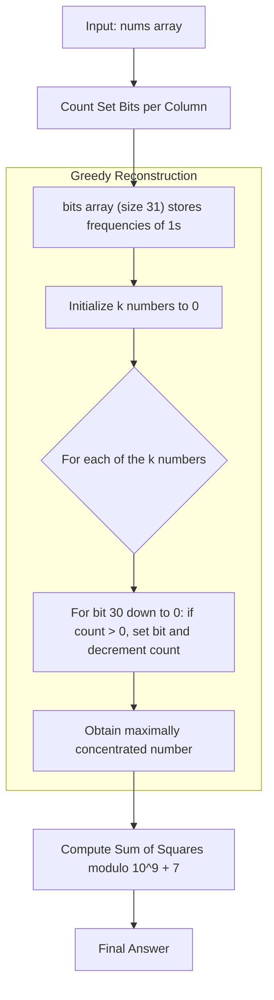

<h2><a href="https://leetcode.com/problems/apply-operations-on-array-to-maximize-sum-of-squares">2897. Apply Operations on Array to Maximize Sum of Squares</a></h2>

<p>You are given a <strong>0-indexed</strong> integer array <code>nums</code> and a <strong>positive</strong> integer <code>k</code>.</p>

<p>You can do the following operation on the array <strong>any</strong> number of times:</p>

<ul>
	<li>Choose any two distinct indices <code>i</code> and <code>j</code> and <strong>simultaneously</strong> update the values of <code>nums[i]</code> to <code>(nums[i] AND nums[j])</code> and <code>nums[j]</code> to <code>(nums[i] OR nums[j])</code>. Here, <code>OR</code> denotes the bitwise <code>OR</code> operation, and <code>AND</code> denotes the bitwise <code>AND</code> operation.</li>
</ul>

<p>You have to choose <code>k</code> elements from the final array and calculate the sum of their <strong>squares</strong>.</p>

<p>Return <em>the <strong>maximum</strong> sum of squares you can achieve</em>.</p>

<p>Since the answer can be very large, return it <strong>modulo</strong> <code>10<sup>9</sup> + 7</code>.</p>

<p>&nbsp;</p>
<p><strong class="example">Example 1:</strong></p>

<pre><strong>Input:</strong> nums = [2,6,5,8], k = 2
<strong>Output:</strong> 261
<strong>Explanation:</strong> We can do the following operations on the array:
- Choose i = 0 and j = 3, then change nums[0] to (2 AND 8) = 0 and nums[3] to (2 OR 8) = 10. The resulting array is nums = [0,6,5,10].
- Choose i = 2 and j = 3, then change nums[2] to (5 AND 10) = 0 and nums[3] to (5 OR 10) = 15. The resulting array is nums = [0,6,0,15].
We can choose the elements 15 and 6 from the final array. The sum of squares is 15<sup>2</sup> + 6<sup>2</sup> = 261.
It can be shown that this is the maximum value we can get.
</pre>

<p><strong class="example">Example 2:</strong></p>

<pre><strong>Input:</strong> nums = [4,5,4,7], k = 3
<strong>Output:</strong> 90
<strong>Explanation:</strong> We do not need to apply any operations.
We can choose the elements 7, 5, and 4 with a sum of squares: 7<sup>2</sup> + 5<sup>2</sup> + 4<sup>2</sup> = 90.
It can be shown that this is the maximum value we can get.
</pre>

<p>&nbsp;</p>
<p><strong>Constraints:</strong></p>

<ul>
	<li><code>1 &lt;= k &lt;= nums.length &lt;= 10<sup>5</sup></code></li>
	<li><code>1 &lt;= nums[i] &lt;= 10<sup>9</sup></code></li>
</ul>


---

# 🛍️ Apply-Operations-on-Array-to-Maximize-Sum-of-Squares | Explained

## Approach 1: Bit Manipulation via Greedy Bit Accumulation

### Intuition

To understand this problem, examine what the operation actually does:
Taking two numbers $x$ and $y$ and replacing them with $(x \text{ AND } y)$ and $(x \text{ OR } y)$ does not create or destroy any set bits (`1`s). For any bit position:
- If both numbers have a `1` at position $b$, both retain it ($1 \text{ AND } 1 = 1$, $1 \text{ OR } 1 = 1$).
- If both have a `0`, both remain `0`.
- If one has a `1` and the other has a `0`, the `1` is migrated entirely to the $\text{OR}$ result, and the $\text{AND}$ result receives a `0` ($1 \text{ OR } 0 = 1$, $1 \text{ AND } 0 = 0$).

**Real-World Analogy:**
Imagine you have two people carrying coins of various denominations ($1, 2, 4, 8, \dots$). The operation allows them to pool their coins: whenever only one person has a specific coin, that coin is given to Person A, leaving Person B with nothing for that denomination. You are transferring wealth from one person to another without losing total coins.

**Why Maximize Squares?**
Algebraically, for any two positive values where $a \ge b$ and a shift $c > 0$:
$$(a + c)^2 + (b - c)^2 = a^2 + b^2 + 2c(a - b) + 2c^2 > a^2 + b^2$$
The sum of squares strictly increases when the numbers are as unequal as possible. To maximize the sum of squares of $k$ chosen elements, you must make the top $k$ numbers as large as possible by concentrating all available `1`-bits into them greedily.

---

### Algorithm Visualized



---

### Approach

1. **Count Bit Frequencies:**
   Since each number in the array is bounded by $10^9 < 2^{30}$, we only need to track bits from index `0` to `30`. We iterate through all numbers in `nums` and count how many times each bit position is set across the entire array.

2. **Greedily Assemble $k$ Maximum Numbers:**
   We construct the $k$ numbers one by one. For each number, we inspect bit positions from 30 down to 0. If there is at least one unused set bit at position `bit`, we set that bit in our current number and decrement the count in our frequency array.

3. **Accumulate Modulo Sum of Squares:**
   Once each of the $k$ numbers is constructed, we square each number, apply the modulo operation at each step, and sum them up.

---

### Detailed Code Analysis

#### 1. Constants and Frequency Array Setup
```java
private final int MOD = 1000000007;
public int maxSum(List<Integer> nums, int k) {
    int[] bits = new int[31];
```
- `MOD = 1000000007`: Standard prime modulo used to prevent integer overflow in large summation problems.
- `int[] bits = new int[31]`: An array of size 31 where index `i` tracks how many elements in `nums` have their $i$-th bit set ($2^i$).

#### 2. Tallying Bit Frequencies
```java
for (int num : nums) {
    for (int i = 0; i < 31; i++) {
        if ((num & (1 << i)) != 0) {
            bits[i]++;
        }
    }
}
```
- Loops through every element `num` in `nums`.
- `(num & (1 << i)) != 0`: Shifts `1` by `i` positions to create a bitmask for the $i$-th bit. If the bitwise AND is non-zero, that bit is active in `num`.
- `bits[i]++`: Increments the global pool of available `1`s at position `i`.

#### 3. Greedily Constructing the $k$ Numbers
```java
long ans[] = new long[k];
for (int i = 0; i < k; i++) {
    long currNum = 0;
    for (int bit = 30; bit >= 0; bit--) {
        if (bits[bit] > 0) {
            currNum |= (1 << bit);
            bits[bit]--;
        }
    }
    ans[i] = currNum;
}
```
- `ans`: An array of size `k` to store the reconstructed $k$ largest values.
- `currNum |= (1 << bit)`: Sets the bit at position `bit` in `currNum`.
- `bits[bit]--`: Consumes one `1` from the pool.
- Because we do this for the first number, then the second, up to the $k$-th number, the first number gets all possible bits, the second gets all remaining bits, and so on. This produces the maximal possible values for the top $k$ positions.

#### 4. Calculating the Sum of Squares
```java
long sum = 0;
for (long num : ans) {
    sum = (sum + (num * num) % MOD) % MOD;
}
return (int) sum;
```
- `num * num`: Squares the value. Note that `currNum` fits within a 32-bit integer, but its square can exceed $2^{31}-1$, so using `long` prevents intermediate overflow.
- `(sum + (num * num) % MOD) % MOD`: Safely adds the square under modulo $10^9 + 7$.
- Casts `sum` back to an `int` for the final return value.

---

### Code

```java
class Solution {
    private final int MOD = 1000000007;

    public int maxSum(List<Integer> nums, int k) {
        int[] bits = new int[31];
        
        // Count the occurrences of each bit across all numbers
        for (int num : nums) {
            for (int i = 0; i < 31; i++) {
                if ((num & (1 << i)) != 0) {
                    bits[i]++;
                }
            }
        }

        // Greedily build the k largest numbers
        long[] ans = new long[k];
        for (int i = 0; i < k; i++) {
            long currNum = 0;
            for (int bit = 30; bit >= 0; bit--) {
                if (bits[bit] > 0) {
                    currNum |= (1 << bit);
                    bits[bit]--;
                }
            }
            ans[i] = currNum;
        }

        // Calculate the sum of squares modulo 10^9 + 7
        long sum = 0;
        for (long num : ans) {
            sum = (sum + (num * num) % MOD) % MOD;
        }

        return (int) sum;
    }
}
```

---

### Complexity

- **Time Complexity:** $\mathcal{O}(N \times 31 + K \times 31) = \mathcal{O}(N + K)$
  - Counting bits: We iterate through $N$ numbers and inspect $31$ bits for each, requiring $31 \times N$ operations.
  - Reconstructing numbers: We build $K$ numbers across $31$ bits, requiring $31 \times K$ operations.
  - Summing squares: Takes $\mathcal{O}(K)$ operations.
  - Overall time complexity is strictly linear with respect to the input size $\mathcal{O}(N)$ since $K \le N$.

- **Space Complexity:** $\mathcal{O}(K)$
  - `bits` frequency array requires $\mathcal{O}(1)$ space (fixed size of 31).
  - `ans` array stores $K$ numbers, requiring $\mathcal{O}(K)$ auxiliary space.

---

## 🕵️‍♂️ Follow-up Questions (Optional)

1. **Can we optimize the auxiliary space to $\mathcal{O}(1)$?**
   Yes. Instead of storing the reconstructed numbers in the `ans` array of size $k$, you can compute `(currNum * currNum) % MOD` and accumulate it directly into `sum` within the greedy reconstruction loop.

2. **What if the values in `nums` could be up to $10^{18}$ (64-bit integers)?**
   The logic remains identical, but the bit size increases from 31 to 62. Additionally, bit shifts must use `1L << bit` instead of `1 << bit` to avoid 32-bit overflow during the bitwise operations.