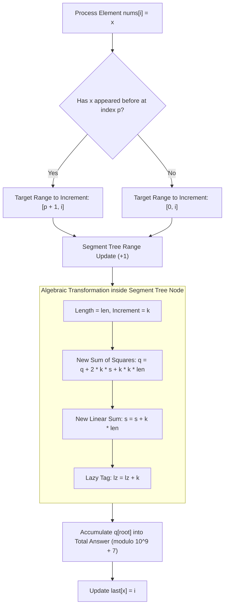

<h2><a href="https://leetcode.com/problems/subarrays-distinct-element-sum-of-squares-ii">2916. Subarrays Distinct Element Sum of Squares II</a></h2>

<p>You are given a <strong>0-indexed </strong>integer array <code>nums</code>.</p>

<p>The <strong>distinct count</strong> of a subarray of <code>nums</code> is defined as:</p>

<ul>
	<li>Let <code>nums[i..j]</code> be a subarray of <code>nums</code> consisting of all the indices from <code>i</code> to <code>j</code> such that <code>0 &lt;= i &lt;= j &lt; nums.length</code>. Then the number of distinct values in <code>nums[i..j]</code> is called the distinct count of <code>nums[i..j]</code>.</li>
</ul>

<p>Return <em>the sum of the <strong>squares</strong> of <strong>distinct counts</strong> of all subarrays of </em><code>nums</code>.</p>

<p>Since the answer may be very large, return it <strong>modulo</strong> <code>10<sup>9</sup> + 7</code>.</p>

<p>A subarray is a contiguous <strong>non-empty</strong> sequence of elements within an array.</p>

<p>&nbsp;</p>
<p><strong>Example 1:</strong></p>

<pre><strong>Input:</strong> nums = [1,2,1]
<strong>Output:</strong> 15
<strong>Explanation:</strong> Six possible subarrays are:
[1]: 1 distinct value
[2]: 1 distinct value
[1]: 1 distinct value
[1,2]: 2 distinct values
[2,1]: 2 distinct values
[1,2,1]: 2 distinct values
The sum of the squares of the distinct counts in all subarrays is equal to 1<sup>2</sup> + 1<sup>2</sup> + 1<sup>2</sup> + 2<sup>2</sup> + 2<sup>2</sup> + 2<sup>2</sup> = 15.
</pre>

<p><strong>Example 2:</strong></p>

<pre><strong>Input:</strong> nums = [2,2]
<strong>Output:</strong> 3
<strong>Explanation:</strong> Three possible subarrays are:
[2]: 1 distinct value
[2]: 1 distinct value
[2,2]: 1 distinct value
The sum of the squares of the distinct counts in all subarrays is equal to 1<sup>2</sup> + 1<sup>2</sup> + 1<sup>2</sup> = 3.</pre>

<p>&nbsp;</p>
<p><strong>Constraints:</strong></p>

<ul>
	<li><code>1 &lt;= nums.length &lt;= 10<sup>5</sup></code></li>
	<li><code>1 &lt;= nums[i] &lt;= 10<sup>5</sup></code></li>
</ul>


---

# 🛍️ Subarrays-Distinct-Element-Sum-of-Squares-II | Explained

## Approach 1: Dynamic Range Increment with Lazy Segment Tree

### Intuition

Imagine you are standing beside a conveyor belt observing items passing by one by one. At every step $i$, you want to evaluate all subarrays ending at index $i$, denoted as $nums[j \dots i]$ for all $0 \le j \le i$. 

Let $d(j)$ represent the number of distinct elements in the subarray $nums[j \dots i]$. When the conveyor belt advances from index $i - 1$ to index $i$, a new element $x = nums[i]$ arrives:
1. If $x$ has never appeared before, it is a brand-new distinct value for **all** starting positions $j \in [0, i]$.
2. If $x$ was seen previously at index $p = \text{last}[x]$, then for any starting position $j \le p$, the subarray $nums[j \dots i]$ already contains $x$, so its distinct count does not change.
3. However, for any starting position $j \in [p + 1, i]$, the element $x$ is completely new! Therefore, for every $j \in [p + 1, i]$, the distinct count increases by $1$:
$$d(j) \leftarrow d(j) + 1$$

We need to compute the sum of squares $\sum_{j=0}^i (d(j))^2$ at each step $i$. 

When a value $d$ increases by $k$, its square changes according to the algebraic expansion:
$$(d + k)^2 = d^2 + 2kd + k^2$$

Summing this identity over a contiguous range of length $len$:
$$\sum (d + k)^2 = \sum d^2 + 2k \sum d + k^2 \cdot len$$

This means that to maintain the sum of squares ($\sum d^2$) after a range addition, we only need to simultaneously maintain the linear sum ($\sum d$). A **Segment Tree with Lazy Propagation** is the ideal data structure to support both range additions and range sum-of-squares queries in $O(\log n)$ time.

---

### Algorithm Visualized



---

### Approach

1. **State Maintenance**:
   - For a fixed right boundary $i$, let each leaf $j$ in our segment tree store the value $d(j)$, which is the number of distinct elements in $nums[j \dots i]$.
   - Each segment tree node covering a range of starting indices tracks:
     - `s[o]`: The linear sum of distinct elements, $\sum d(j)$.
     - `q[o]`: The sum of squares of distinct elements, $\sum (d(j))^2$.
     - `lz[o]`: The lazy propagation tag tracking pending additions to all elements in this subtree.
2. **Transition on Element $nums[i]$**:
   - Look up the previous occurrence $p = \text{last}[nums[i]]$. If not seen before, $p = -1$.
   - The arrival of $nums[i]$ introduces a new distinct element exclusively to subarrays starting in the interval $[p + 1, i]$.
   - Perform a range addition of $+1$ over $[p + 1, i]$ in the segment tree.
3. **Updating Node Values**:
   - When adding $k$ to a node covering a segment of size $len$:
     $$\Delta q = 2k \cdot s + k^2 \cdot len$$
     $$\Delta s = k \cdot len$$
   - Push lazy tags down to children before traversing deeper into the tree.
4. **Answer Accumulation**:
   - After updating the range $[p + 1, i]$, the root node of the tree ($o = 1$) holds the sum of squares $\sum_{j=0}^i (d(j))^2$ across all valid start positions $j \in [0, i]$ (indices $> i$ remain 0).
   - Add `q[1]` directly to `ans` modulo $10^9 + 7$.
   - Update $\text{last}[nums[i]] = i$.

---

### Detailed Code Analysis

#### 1. Lazy Application Helper (`app`)
```java
void app(int o, int len, long k) {
    q[o] += 2 * k * s[o] + k * k * len;
    s[o] += k * len;
    lz[o] += k;
}
```
- **Line 5**: Updates the sum of squares $q[o]$. By the algebraic expansion $(d+k)^2 = d^2 + 2kd + k^2$, the new sum of squares is $q_{\text{new}} = q_{\text{old}} + 2k \sum d + k^2 \cdot len$. Notice $s[o]$ represents $\sum d$, so `2 * k * s[o]` accounts for the cross-term, and `k * k * len` accounts for the constant term over all $len$ elements.
- **Line 6**: Updates the linear sum $s[o]$ by adding $k \times len$.
- **Line 7**: Accumulates $k$ onto the lazy tag `lz[o]` to be pushed down to children during future operations.
- *Overflow Consideration*: Inside the tree, intermediate values fit within a 64-bit signed integer (`long`). Since $n \le 10^5$, $d(j) \le n \implies (d(j))^2 \le 10^{10}$, and the total sum over $n$ elements is at most $n \times n^2 = n^3 = 10^{15} < 2^{63}-1$. Avoiding modulo operations inside `app` significantly improves runtime.

#### 2. Segment Tree Range Update (`upd`)
```java
void upd(int o, int l, int r, int L, int R) {
    if (L <= l && r <= R) { app(o, r - l + 1, 1); return; }
    int m = (l + r) >> 1;
    if (lz[o] != 0) {
        app(2*o, m - l + 1, lz[o]);
        app(2*o+1, r - m, lz[o]);
        lz[o] = 0;
    }
    if (L <= m) upd(2*o, l, m, L, R);
    if (R > m) upd(2*o+1, m+1, r, L, R);
    s[o] = s[2*o] + s[2*o+1];
    q[o] = q[2*o] + q[2*o+1];
}
```
- **Line 11**: Base condition for range overlap. If current segment $[l, r]$ is completely inside the target update range $[L, R]$, apply the update directly to node $o$ with $k = 1$ and return.
- **Lines 12–17 (Push-Down)**: If the current node cannot be fully updated and has a pending lazy tag (`lz[o] != 0`), it pushes the lazy tag down to its left child ($2o$, size $m - l + 1$) and right child ($2o + 1$, size $r - m$), then clears `lz[o]`.
- **Lines 18–19**: Recurse into the left child if $[L, R]$ overlaps with $[l, m]$, and into the right child if $[L, R]$ overlaps with $[m + 1, r]$.
- **Lines 20–21 (Push-Up)**: Recompute current node's linear sum $s[o]$ and quadratic sum $q[o]$ by summing the values of its children.

#### 3. Main Algorithm (`sumCounts`)
```java
public int sumCounts(int[] nums) {
    final long MOD = 1_000_000_007L;
    int n = nums.length;
    s = new long[4*n]; q = new long[4*n]; lz = new long[4*n];
    int[] last = new int[100001];
    java.util.Arrays.fill(last, -1);
    long ans = 0;
    for (int i = 0; i < n; i++) {
        upd(1, 0, n-1, last[nums[i]] + 1, i);
        last[nums[i]] = i;
        ans = (ans + q[1]) % MOD;
    }
    return (int) ans;
}
```
- **Lines 26–29**: Allocates $4n$ space for the tree arrays. Allocates `last` array up to $100,001$ (based on the problem constraint $nums[i] \le 10^5$) initialized to $-1$.
- **Line 32**: When processing $nums[i]$, range $[last[nums[i]] + 1, i]$ receives a $+1$ increment. Subarrays starting before $last[nums[i]] + 1$ already included $nums[i]$, so their counts are unaffected.
- **Line 33**: Updates the latest occurrence of $nums[i]$ to $i$.
- **Line 34**: `q[1]` stores the sum of squares of all subarrays ending at $i$. We add this to `ans` modulo $10^9+7$.
- **Line 36**: Returns the total sum as an integer.

---

### Code

```java
class Solution {
    long[] s, q, lz;

    void app(int o, int len, long k) {
        q[o] += 2 * k * s[o] + k * k * len;
        s[o] += k * len;
        lz[o] += k;
    }

    void upd(int o, int l, int r, int L, int R) {
        if (L <= l && r <= R) { 
            app(o, r - l + 1, 1); 
            return; 
        }
        int m = (l + r) >> 1;
        if (lz[o] != 0) {
            app(2 * o, m - l + 1, lz[o]);
            app(2 * o + 1, r - m, lz[o]);
            lz[o] = 0;
        }
        if (L <= m) upd(2 * o, l, m, L, R);
        if (R > m) upd(2 * o + 1, m + 1, r, L, R);
        s[o] = s[2 * o] + s[2 * o + 1];
        q[o] = q[2 * o] + q[2 * o + 1];
    }

    public int sumCounts(int[] nums) {
        final long MOD = 1_000_000_007L;
        int n = nums.length;
        s = new long[4 * n]; 
        q = new long[4 * n]; 
        lz = new long[4 * n];
        int[] last = new int[100001];
        java.util.Arrays.fill(last, -1);
        long ans = 0;
        for (int i = 0; i < n; i++) {
            upd(1, 0, n - 1, last[nums[i]] + 1, i);
            last[nums[i]] = i;
            ans = (ans + q[1]) % MOD;
        }
        return (int) ans;
    }
}
```

---

### Complexity

- **Time Complexity:** $\mathcal{O}(n \log n)$
  - There are $n$ iterations in the loop.
  - In each iteration, `upd` visits at most $\mathcal{O}(\log n)$ nodes in the segment tree due to standard segment tree interval decomposition.
  - Array lookups and updates in `last` take $\mathcal{O}(1)$ time.
  - Total Time: $\mathcal{O}(n \log n)$.

- **Space Complexity:** $\mathcal{O}(n + U)$ where $U = \max(nums[i]) \le 100,000$
  - The segment tree arrays `s`, `q`, and `lz` each require $4n$ space, totaling $\mathcal{O}(n)$ auxiliary space.
  - The `last` array requires space proportional to the maximum possible value of elements in `nums`, which is bounded by $10^5+1$.
  - Total Auxiliary Space: $\mathcal{O}(n + U)$.

---

## 🕵️‍♂️ Follow-up Questions

### 1. Why is it safe to avoid taking modulo inside the segment tree methods (`app` and `upd`)?
**Answer:** 
The maximum value of any distinct count $d(j)$ is $n \le 10^5$. Consequently, the maximum sum of squares in the tree is:
$$\sum_{j=0}^{n-1} (d(j))^2 \le n \times n^2 = n^3 = (10^5)^3 = 10^{15}$$
In Java, a signed 64-bit `long` has a maximum value of $2^{63} - 1 \approx 9.22 \times 10^{18}$. Since $10^{15} \ll 9.22 \times 10^{18}$, arithmetic overflow is mathematically impossible during the segment tree updates. Skipping the `% MOD` inside `app` and `upd` removes expensive division operations in the inner loop, yielding a massive constant-factor speedup.

### 2. How would you extend this approach if the problem asked for the sum of cubes of distinct elements: $\sum (d(j))^3$?
**Answer:**
We can generalize the algebraic expansion using the binomial theorem:
$$(d + k)^3 = d^3 + 3kd^2 + 3k^2d + k^3$$
Summing over an interval of length $len$:
$$\sum (d + k)^3 = \sum d^3 + 3k \sum d^2 + 3k^2 \sum d + k^3 \cdot len$$
To support this, the segment tree would simply need to maintain three values per node:
1. `c[o]`: Sum of cubes ($\sum d^3$)
2. `q[o]`: Sum of squares ($\sum d^2$)
3. `s[o]`: Linear sum ($\sum d$)

Each node would update `c[o]`, `q[o]`, and `s[o]` simultaneously in $\mathcal{O}(1)$ time during lazy propagation. However, because $n^4 = 10^{20} > 2^{63}-1$, modulo arithmetic would need to be applied at each step.