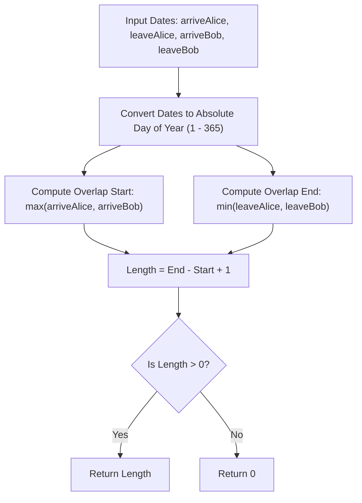

<h2><a href="https://leetcode.com/problems/count-days-spent-together">2409. Count Days Spent Together</a></h2>

<p>Alice and Bob are traveling to Rome for separate business meetings.</p>

<p>You are given 4 strings <code>arriveAlice</code>, <code>leaveAlice</code>, <code>arriveBob</code>, and <code>leaveBob</code>. Alice will be in the city from the dates <code>arriveAlice</code> to <code>leaveAlice</code> (<strong>inclusive</strong>), while Bob will be in the city from the dates <code>arriveBob</code> to <code>leaveBob</code> (<strong>inclusive</strong>). Each will be a 5-character string in the format <code>"MM-DD"</code>, corresponding to the month and day of the date.</p>

<p>Return<em> the total number of days that Alice and Bob are in Rome together.</em></p>

<p>You can assume that all dates occur in the <strong>same</strong> calendar year, which is <strong>not</strong> a leap year. Note that the number of days per month can be represented as: <code>[31, 28, 31, 30, 31, 30, 31, 31, 30, 31, 30, 31]</code>.</p>

<p>&nbsp;</p>
<p><strong class="example">Example 1:</strong></p>

<pre><strong>Input:</strong> arriveAlice = "08-15", leaveAlice = "08-18", arriveBob = "08-16", leaveBob = "08-19"
<strong>Output:</strong> 3
<strong>Explanation:</strong> Alice will be in Rome from August 15 to August 18. Bob will be in Rome from August 16 to August 19. They are both in Rome together on August 16th, 17th, and 18th, so the answer is 3.
</pre>

<p><strong class="example">Example 2:</strong></p>

<pre><strong>Input:</strong> arriveAlice = "10-01", leaveAlice = "10-31", arriveBob = "11-01", leaveBob = "12-31"
<strong>Output:</strong> 0
<strong>Explanation:</strong> There is no day when Alice and Bob are in Rome together, so we return 0.
</pre>

<p>&nbsp;</p>
<p><strong>Constraints:</strong></p>

<ul>
	<li>All dates are provided in the format <code>"MM-DD"</code>.</li>
	<li>Alice and Bob's arrival dates are <strong>earlier than or equal to</strong> their leaving dates.</li>
	<li>The given dates are valid dates of a <strong>non-leap</strong> year.</li>
</ul>


---

# 🛍️ Count-Days-Spent-Together | Explained

## Approach 1: 1D Interval Intersection with Mathematical Day-of-Year Mapping

### Intuition
Think of a year as a single continuous ruler numbered from day `1` to day `365`. Alice and Bob each reserve a segment of this ruler for their travels. 

To find the days they spent together, you are looking for the **overlap of two line segments on a 1D timeline**:
- Alice's interval: $[A_{\text{arrive}}, A_{\text{leave}}]$
- Bob's interval: $[B_{\text{arrive}}, B_{\text{leave}}]$

The mutual visit starts on the day the **latest** person arrives:
$$\text{start} = \max(A_{\text{arrive}}, B_{\text{arrive}})$$

It ends on the day the **earliest** person leaves:
$$\text{end} = \min(A_{\text{leave}}, B_{\text{leave}})$$

If $\text{start} \le \text{end}$, the number of shared inclusive days is simply $\text{end} - \text{start} + 1$. If $\text{start} > \text{end}$, their visits do not overlap at all, resulting in $0$ days.

---

### Algorithm Visualized

```mermaid
gantt
    title Overlapping Date Intervals
    dateFormat X
    axisFormat %d
    
    section Alice
    Alice's Stay (Arrive to Leave) :active, a1, 10, 40
    
    section Bob
    Bob's Stay (Arrive to Leave)   :active, b1, 25, 55
    
    section Overlap
    Days Spent Together           :crit, o1, 25, 40
```





---

### Approach

1. **Parse & Convert to Day of Year**:
   - Convert a date string `"MM-DD"` into an integer representing its day number from the start of the non-leap year (e.g., `"01-01"` $\to 1$, `"12-31"` $\to 365$).
   - Instead of allocating a prefix-sum array for month lengths (`[31, 28, 31, 30, ...]`), compute the cumulative days using an arithmetic formula tailored for common 365-day years.
2. **Compute the Overlapping Interval**:
   - Calculate the effective shared start day: `Math.max(day(arriveAlice), day(arriveBob))`.
   - Calculate the effective shared end day: `Math.min(day(leaveAlice), day(leaveBob))`.
3. **Calculate Total Days**:
   - Compute `overlapEnd - overlapStart + 1`.
   - Guard against negative results using `Math.max(0, ...)` for cases where one leaves before the other arrives.

---

### Detailed Code Analysis

#### Helper Method: `day(String s)`
```java
public int day(String s){
    int month = 10 * (s.charAt(0) - '0') + (s.charAt(1) - '0');
    int date = 10 * (s.charAt(3) - '0') + (s.charAt(4) - '0');
    return (275 * month) / 9 - 30 - 2 * ((month + 9) / 12) + date;
}
```
- **Digit Parsing**:
  - `s.charAt(0) - '0'` converts the character digit to its integer value.
  - Multiplies the tens digit by $10$ and adds the units digit for both the month (indices `0` and `1`) and the day (indices `3` and `4`), skipping the hyphen at index `2`.
- **The Mathematical Month-to-Day Formula**:
  - `(275 * month) / 9 - 30 - 2 * ((month + 9) / 12) + date` is an established integer arithmetic formula (originating from astronomical date-conversion algorithms) that models the cumulative days in prior months for a non-leap year:
    - `(275 * month) / 9 - 30` creates the step pattern that accounts for the alternating $30$ and $31$-day month lengths throughout the year.
    - `- 2 * ((month + 9) / 12)` applies a correction factor for February:
      - When `month` is $1$ (January) or $2$ (February), `(month + 9) / 12` evaluates to `0` via integer division.
      - When `month` $\ge 3$ (March through December), `(month + 9) / 12` evaluates to `1`, subtracting exactly $2$ days to adjust for February's $28$-day length (since $30 - 2 = 28$).
    - Adding `+ date` integrates the current day into the cumulative sum.

#### Main Method: `countDaysTogether(...)`
```java
public int countDaysTogether(String arriveAlice, String leaveAlice, String arriveBob, String leaveBob) {
    return Math.max(0, Math.min(day(leaveAlice), day(leaveBob)) - Math.max(day(arriveAlice), day(arriveBob)) + 1);
}
```
- `Math.max(day(arriveAlice), day(arriveBob))` determines the start of the shared window.
- `Math.min(day(leaveAlice), day(leaveBob))` determines the end of the shared window.
- Adding `+ 1` ensures both boundary days are counted inclusively (e.g., arriving and leaving on the same day counts as $1$ day).
- `Math.max(0, ...)` handles the disjoint condition: if $\text{latest arrival} > \text{earliest departure}$, the subtraction yields a negative number, which is clamped to `0`.

---

### Code

```java
class Solution {
    public int countDaysTogether(String arriveAlice, String leaveAlice, String arriveBob, String leaveBob) {
        return Math.max(0, Math.min(day(leaveAlice), day(leaveBob)) - Math.max(day(arriveAlice), day(arriveBob)) + 1);
    }

    public int day(String s) {
        int month = 10 * (s.charAt(0) - '0') + (s.charAt(1) - '0');
        int date = 10 * (s.charAt(3) - '0') + (s.charAt(4) - '0');
        return (275 * month) / 9 - 30 - 2 * ((month + 9) / 12) + date;
    }
}
```

---

### Complexity

- **Time Complexity:** $\mathcal{O}(1)$  
  String indices accessed are fixed at positions $0, 1, 3, 4$. The mathematical conversions and min/max evaluations execute in constant arithmetic operations with no loops or recursion.

- **Space Complexity:** $\mathcal{O}(1)$  
  Operates strictly with primitive integers on the call stack. No dynamic memory, auxiliary arrays, or lookup tables are allocated.

---

## 🕵️‍♂️ Follow-up Questions

### 1. How would you support leap years using this approach?
In a leap year, February has $29$ days instead of $28$. The correction factor subtracted for months March through December needs to be $1$ day instead of $2$. 

The expression:
$$- 2 \times \left(\frac{\text{month} + 9}{12}\right)$$
becomes:
$$- 1 \times \left(\frac{\text{month} + 9}{12}\right)$$

### 2. Why might an interviewer prefer a lookup table over this mathematical formula?
While the arithmetic formula avoids memory allocation and executes in $\mathcal{O}(1)$, it relies on numerical constants that can be difficult to verify or maintain. In production systems or team environments, a prefix sum array such as `int[] daysBeforeMonth = {0, 31, 59, 90, ...}` is often preferred for readability, maintainability, and self-documenting intent.