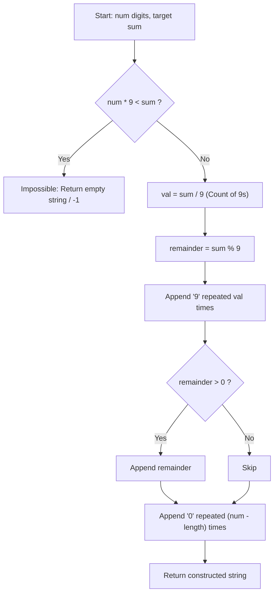

<h2><a href="https://leetcode.com/problems/maximize-sum-of-squares-of-digits">3723. Maximize Sum of Squares of Digits</a></h2>

<p>You are given two <strong>positive</strong> integers <code>num</code> and <code>sum</code>.</p>

<p>A positive integer <code>n</code> is <strong>good</strong> if it satisfies both of the following:</p>

<ul>
	<li>The number of digits in <code>n</code> is <strong>exactly</strong> <code>num</code>.</li>
	<li>The sum of digits in <code>n</code> is <strong>exactly</strong> <code>sum</code>.</li>
</ul>

<p>The <strong>score</strong> of a <strong>good</strong> integer <code>n</code> is the sum of the squares of digits in <code>n</code>.</p>

<p>Return a <strong>string</strong> denoting the <strong>good</strong> integer <code>n</code> that achieves the <strong>maximum</strong> <strong>score</strong>. If there are multiple possible integers, return the <strong>maximum </strong>​​​​​​​one. If no such integer exists, return an empty string.</p>

<p>&nbsp;</p>
<p><strong class="example">Example 1:</strong></p>

<div class="example-block">
<p><strong>Input:</strong> <span class="example-io">num = 2, sum = 3</span></p>

<p><strong>Output:</strong> <span class="example-io">"30"</span></p>

<p><strong>Explanation:</strong></p>

<p>There are 3 good integers: 12, 21, and 30.</p>

<ul>
	<li>The score of 12 is <code>1<sup>2</sup> + 2<sup>2</sup> = 5</code>.</li>
	<li>The score of 21 is <code>2<sup>2</sup> + 1<sup>2</sup> = 5</code>.</li>
	<li>The score of 30 is <code>3<sup>2</sup> + 0<sup>2</sup> = 9</code>.</li>
</ul>

<p>The maximum score is 9, which is achieved by the good integer 30. Therefore, the answer is <code>"30"</code>.</p>
</div>

<p><strong class="example">Example 2:</strong></p>

<div class="example-block">
<p><strong>Input:</strong> <span class="example-io">num = 2, sum = 17</span></p>

<p><strong>Output:</strong> <span class="example-io">"98"</span></p>

<p><strong>Explanation:</strong></p>

<p>There are 2 good integers: 89 and 98.</p>

<ul>
	<li>The score of 89 is <code>8<sup>2</sup> + 9<sup>2</sup> = 145</code>.</li>
	<li>The score of 98 is <code>9<sup>2</sup> + 8<sup>2</sup> = 145</code>.</li>
</ul>

<p>The maximum score is 145. The maximum good integer that achieves this score is 98. Therefore, the answer is <code>"98"</code>.</p>
</div>

<p><strong class="example">Example 3:</strong></p>

<div class="example-block">
<p><strong>Input:</strong> <span class="example-io">num = 1, sum = 10</span></p>

<p><strong>Output:</strong> <span class="example-io">""</span></p>

<p><strong>Explanation:</strong></p>

<p>There are no integers that have exactly 1 digit and whose digits sum to 10. Therefore, the answer is <code>""</code>.</p>
</div>

<p>&nbsp;</p>
<p><strong>Constraints:</strong></p>

<ul>
	<li><code>1 &lt;= num &lt;= 2 * 10<sup>5</sup></code></li>
	<li><code>1 &lt;= sum &lt;= 2 * 10<sup>6</sup></code></li>
</ul>


---

# 🛍️ Maximize-Sum-of-Squares-of-Digits | Explained

## Approach 1: Direct Mathematical Partition (Optimized)

### Intuition
To maximize the sum of squares $\sum d_i^2$ for a fixed sum of digits $\sum d_i = \text{sum}$, we take advantage of **convexity**. 

Think of it like packing weights into boxes with a maximum capacity of 9 kg each. If you have two boxes with weights $a$ and $b$ (where $a \ge b$), and you transfer 1 kg from box $b$ to box $a$, the change in the sum of squares is:
$$((a + 1)^2 + (b - 1)^2) - (a^2 + b^2) = 2(a - b) + 2 > 0$$

Because $a \ge b$, transferring weight to make the larger number even larger **strictly increases** the total sum of squares. Therefore, to achieve the absolute maximum, we must make individual digits as extreme as possible: as many `9`s as we can fit, at most one leftover digit, and the rest `0`s.

Rather than iterating digit by digit, we can compute the exact counts of `9`s, the leftover remainder, and the padding `0`s in $O(1)$ arithmetic operations.

### Algorithm Visualized



---

### Approach
1. **Feasibility Check:** The maximum sum achievable with `num` digits is `num * 9`. If `sum > num * 9`, no valid number can be formed.
2. **Calculate the Maximum Number of 9s:** Using integer division, `val = sum / 9` tells us exactly how many `9`s can be fully saturated.
3. **Calculate the Remainder:** Using modulo arithmetic, `remainder = sum % 9` gives the single digit needed to reach the exact target sum.
4. **Pad with Zeros:** Fill the remaining `num - length` digit positions with `'0'` to satisfy the `num`-digit requirement.

---

### Detailed Code Analysis
- **Line 3–5 (`if (num * 9 < sum)`):** Verifies if the requested sum exceeds the physical ceiling of `num` 9-digit values. If impossible, it returns an empty string `""` (or error indicator).
- **Line 7–8 (`int val = sum / 9; sum = sum % 9;`):** Directly computes the maximum number of `9`s via division and retains the single sub-9 digit using the modulo operator.
- **Line 9 (`StringBuilder sb = new StringBuilder("9".repeat(val));`):** Pre-allocates and places all `9`s in bulk. *(Note: Java's `.repeat()` belongs to the `String` class, so `"9".repeat(val)` is used).*
- **Line 10–12 (`if (sum > 0) sb.append(sum);`):** Appends the leftover remainder digit if it is non-zero.
- **Line 13 (`sb.append("0".repeat(num - sb.length()));`):** Computes how many digits are left to reach `num` and fills them entirely with `0`.
- **Line 14 (`return sb.toString();`):** Converts the `StringBuilder` to the final result string.

---

### Code
```java
class Solution {
    public String maxSumOfSquares(int num, int sum) {
        // Feasibility check: num digits can at most sum to num * 9
        if (num * 9 < sum) {
            return "";
        }
        
        int val = sum / 9;
        sum = sum % 9;
        
        StringBuilder sb = new StringBuilder("9".repeat(val));
        if (sum > 0) {
            sb.append(sum);
        }
        sb.append("0".repeat(num - sb.length()));
        
        return sb.toString();
    }
}
```

---

### Complexity
- **Time Complexity:** $O(\text{num})$ — The arithmetic operations run in $O(1)$ time. Constructing the output string of length `num` via `.repeat()` and `StringBuilder` takes time linear to the number of digits.
- **Space Complexity:** $O(\text{num})$ auxiliary space to store the constructed result string of length `num`.

---

## Approach 2: Greedy Iterative Allocation

### Intuition
If you were handing out up to 9 coins at each step to reach a target sum within a fixed number of slots, you would greedily dump the maximum possible amount (`min(sum, 9)`) into the current slot, decrease the remaining sum, and move to the next slot until all slots are filled.

This processes the digits sequentially from left to right, naturally generating the digits in descending order.

### Algorithm Visualized

```mermaid
sequenceDiagram
    autonumber
    actor Driver as Caller
    participant Loop as While Loop (num > 0)
    participant SB as StringBuilder
    
    Driver->>Loop: Initialize: num, sum
    loop While num > 0
        Loop->>Loop: val = min(sum, 9)
        Loop->>SB: append(val)
        Loop->>Loop: sum = sum - val
        Loop->>Loop: num = num - 1
    end
    Loop->>Driver: If sum > 0 return "" else return SB
```

---

### Approach
1. Initialize an empty `StringBuilder`.
2. Loop while `num > 0`:
   - Determine the largest valid digit we can afford: `val = Math.min(sum, 9)`.
   - Append `val` to our `StringBuilder`.
   - Decrement `num` by 1 and subtract `val` from `sum`.
3. After the loop, if `sum > 0`, it means even using all `9`s was not enough to exhaust `sum`. Return an empty string `""`. Otherwise, return the accumulated string.

---

### Detailed Code Analysis
- **Line 20 (`StringBuilder sb = new StringBuilder();`):** Allocates a mutable buffer to collect digits one by one.
- **Line 21 (`while (num > 0)`):** Guarantees that exactly `num` digits will be produced.
- **Line 22 (`int val = Math.min(sum, 9);`):** The greedy choice. Takes 9 if `sum >= 9`, or the remaining `sum` if `sum < 9`, or `0` if `sum == 0`.
- **Line 23–25 (`sb.append(val); num--; sum -= val;`):** Consumes one digit slot, reduces the target sum, and appends the chosen digit.
- **Line 27 (`return sum > 0 ? "" : sb.toString();`):** Handles edge cases where `sum` could not be fully reduced to 0, ensuring impossible cases return an empty string.

---

### Code
```java
class Solution {
    public String maxSumOfSquares(int num, int sum) {
        StringBuilder sb = new StringBuilder();
        
        while (num > 0) {
            int val = Math.min(sum, 9);
            sb.append(val);
            num--;
            sum -= val;
        }
        
        return sum > 0 ? "" : sb.toString();
    }
}
```

---

### Complexity
- **Time Complexity:** $O(\text{num})$ — The loop executes exactly `num` times, performing constant-time $O(1)$ operations per step.
- **Space Complexity:** $O(\text{num})$ auxiliary space to build and return the final string.

---

## 🕵️‍♂️ Follow-up Questions

### 1. What if the problem asked to MINIMIZE the sum of squares instead of maximizing it?
- **Answer:** By the same convexity property (Jensen's inequality), to minimize $\sum d_i^2$, digits must be as **equal and balanced** as possible rather than extreme. You would compute the base value `base = sum / num` and the remainder `rem = sum % num`. Then, `rem` digits would be `base + 1`, and the remaining `num - rem` digits would be `base`.

### 2. What if leading zeros are strictly forbidden (i.e., the result must be a valid positive integer)?
- **Answer:** For maximum sum of squares, placing `9`s at the front naturally prevents leading zeros as long as `sum > 0`. If `sum == 0`, a valid `num`-digit number cannot be formed without leading zeros (unless `num == 1`, yielding `"0"`). If minimizing the sum of squares, ensure the very first digit is allocated at least `1` before distributing the remaining sum across all digits.