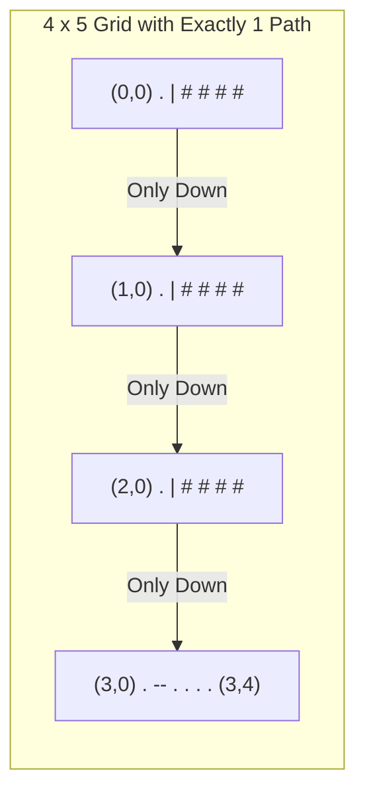

<h2><a href="https://leetcode.com/problems/create-grid-with-exactly-one-path">3963. Create Grid With Exactly One Path</a></h2>

<p>You are given two integers <code>m</code> and <code>n</code>, representing the number of rows and columns of a grid.</p>

<p>Construct <strong>any</strong> <code>m x n</code> grid consisting only of the characters <code>'.'</code> and <code>'#'</code>, where:</p>

<ul>
	<li><code>'.'</code> represents a free cell.</li>
	<li><code>'#'</code> represents an obstacle cell.</li>
</ul>

<p>A <strong>valid path</strong> is a sequence of free cells that:</p>

<ul>
	<li>Starts at the top-left cell <code>(0, 0)</code>.</li>
	<li>Ends at the bottom-right cell <code>(m - 1, n - 1)</code>.</li>
	<li>Moves only:
	<ul>
		<li>Right, from <code>(i, j)</code> to <code>(i, j + 1)</code>, or</li>
		<li>Down, from <code>(i, j)</code> to <code>(i + 1, j)</code>.</li>
	</ul>
	</li>
</ul>

<p>Return any grid such that there is <strong>exactly one valid path</strong> from the top-left cell to the bottom-right cell.</p>

<p>&nbsp;</p>
<p><strong class="example">Example 1:</strong></p>

<div class="example-block">
<p><strong>Input:</strong> <span class="example-io">m = 2, n = 3</span></p>

<p><strong>Output:</strong> <span class="example-io">["..#","#.."]</span></p>

<p><strong>Explanation:</strong></p>

<p></p>

<p>The only valid path is: <code>(0,0) → (0,1) → (1,1) → (1,2)</code></p>
</div>

<p><strong class="example">Example 2:</strong></p>

<div class="example-block">
<p><strong>Input:</strong> <span class="example-io">m = 3, n = 3</span></p>

<p><strong>Output:</strong> <span class="example-io">["..#","#..","##."]</span></p>

<p><strong>Explanation:</strong></p>

<p></p>

<p>The only valid path is: <code>(0,0) → (0,1) → (1,1) → (1,2) → (2,2)</code></p>
</div>

<p><strong class="example">Example 3:</strong></p>

<div class="example-block">
<p><strong>Input:</strong> <span class="example-io">m = 1, n = 4</span></p>

<p><strong>Output:</strong> <span class="example-io">["...."]</span></p>

<p><strong>Explanation:</strong></p>

<p>The only valid path is: <code>(0,0) → (0,1) → (0,2) → (0,3)</code></p>
</div>

<p>&nbsp;</p>
<p><strong>Constraints:</strong></p>

<ul>
	<li><code>1 &lt;= m, n &lt;= 25</code></li>
</ul>


---

# 🛍️ Create-Grid-With-Exactly-One-Path | Explained

## Approach 1: L-Shaped Corridor Construction (Deterministic Border Routing)

### Intuition
In a standard $m \times n$ grid moving only down and right, an empty grid full of open spaces (`'.'`) creates an exponential number of unique paths given by the binomial coefficient:

$$\binom{m + n - 2}{m - 1}$$

To guarantee that there is **exactly one** valid path from the start cell `(0, 0)` to the destination cell `(m - 1, n - 1)`, we must eliminate all branching decisions. 

Think of this like a canal or a single hallway in a building. If every cell has choices to branch off, the path count multiplies. However, if we wall off (`'#'`) every possible detour and leave only a single "L-shaped" corridor—forcing the traveler to move straight down the first column (`col = 0`) until the bottom row, and then straight right along the final row (`row = m - 1`) to the finish line—there is strictly one choice at every single step.

---

### Algorithm Visualized

For a grid of size $m = 4, n = 5$, the L-shaped path configuration forces a single path from `(0, 0)` to `(3, 4)`:



At any point on column $0$ (except the last row), moving right is blocked by `'#'`. At the bottom row, moving up is impossible (only right/down moves permitted), leaving a single direct line to the target.

---

### Approach
1. **Initialize Output Array:** Allocate a `String[]` array of length $m$ to store each row of the grid.
2. **Build Obstacle Rows ($0$ to $m - 2$):** 
   - Each of these rows must only have an open cell at column $0$.
   - The remaining $n - 1$ cells are filled with obstacles (`'#'`).
   - Use `Arrays.fill()` to populate rows $0$ through $m - 2$ with the pattern `"." + "#".repeat(n - 1)`.
3. **Build Target Row ($m - 1$):**
   - The final row must allow unimpeded traversal from column $0$ to column $n - 1$.
   - Construct this row with entirely open cells: `"." .repeat(n)`.
4. **Return the Grid:** The resulting array creates a single non-branching path down column $0$ and across row $m - 1$.

---

### Detailed Code Analysis

- **`String[] res = new String[m];`**  
  Allocates an array of size $m$ to hold the row strings.

- **`Arrays.fill(res, 0, m - 1, "." + "#".repeat(n - 1));`**  
  - The method `Arrays.fill(array, fromIndex, toIndex, val)` fills the subarray in the half-open range `[0, m - 1)`. This covers all rows except the final row.
  - `"." + "#".repeat(n - 1)` dynamically creates a string starting with an open path `.` at index `0`, followed by $n - 1$ obstacle characters `#`.
  - If $m = 1$, `fromIndex = 0` and `toIndex = 0`, meaning this loop does nothing (which correctly prevents an out-of-bounds or invalid overwrite).

- **`res[m - 1] = ".".repeat(n);`**  
  - Sets the very last row (index $m - 1$) to consist purely of open cells `.` repeated $n$ times.
  - This allows the path that traveled down column $0$ to traverse horizontally all the way to `(m - 1, n - 1)`.

- **`return res;`**  
  Returns the completed grid representation.

---

### Code

```java
import java.util.Arrays;

class Solution {
    public String[] createGrid(int m, int n) {
        String[] res = new String[m];
        
        // Rows 0 to m - 2: Only column 0 is passable; rest are blocked
        Arrays.fill(res, 0, m - 1, "." + "#".repeat(n - 1));
        
        // Row m - 1: Completely open from column 0 to column n - 1
        res[m - 1] = ".".repeat(n);
        
        return res;
    }
}
```

---

### Complexity

- **Time Complexity:** $\mathcal{O}(m \times n)$  
  - Creating `"." + "#".repeat(n - 1)` takes $\mathcal{O}(n)$ time.
  - Reusing this string reference in `Arrays.fill` for $m - 1$ elements takes $\mathcal{O}(m)$ time.
  - Creating the final row `"." .repeat(n)` takes $\mathcal{O}(n)$ time.
  - Total time to allocate and construct the strings is proportional to the grid dimensions: $\mathcal{O}(m \times n)$.

- **Space Complexity:** $\mathcal{O}(1)$ Auxiliary Space ($\mathcal{O}(m \times n)$ including the output)  
  - No auxiliary data structures are used. The only memory allocated is the required output grid array of size $m \times n$.

---

## 🕵️‍♂️ Follow-up Questions (Optional)

1. **What happens if $m = 1$ or $n = 1$?**
   - If $m = 1$: `Arrays.fill(res, 0, 0, ...)` does nothing. Row $0$ is set to `".".repeat(n)`. The grid is a single horizontal row of open cells, which yields exactly 1 path.
   - If $n = 1$: `"#".repeat(0)` produces an empty string `""`. Rows $0$ through $m - 2$ become `"."`, and row $m - 1$ is also `"."`. The grid is a single vertical column of open cells, which also yields exactly 1 path.
   - The solution handles all boundary conditions seamlessly.

2. **Can this be mirrored along the other boundary?**
   - Yes. You can construct an inverted "L-shape" by making row $0$ entirely open (`".".repeat(n)`) and all subsequent rows $1$ through $m - 1$ blocked except for the last column (`"#".repeat(n - 1) + "."`). The path would then move right along row $0$ and down column $n - 1$.